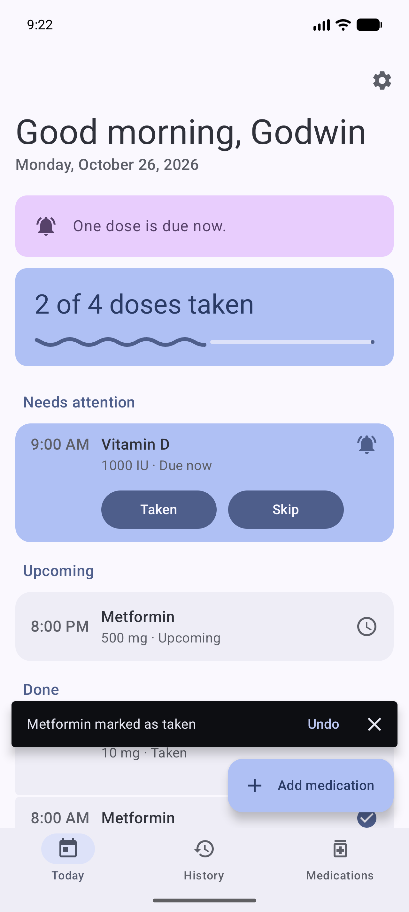
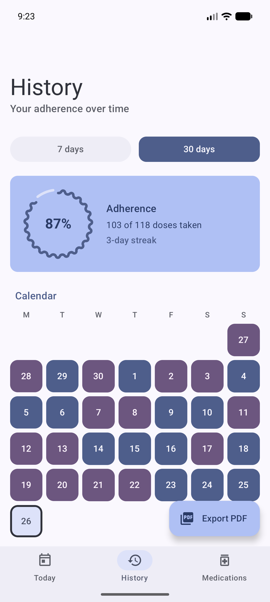
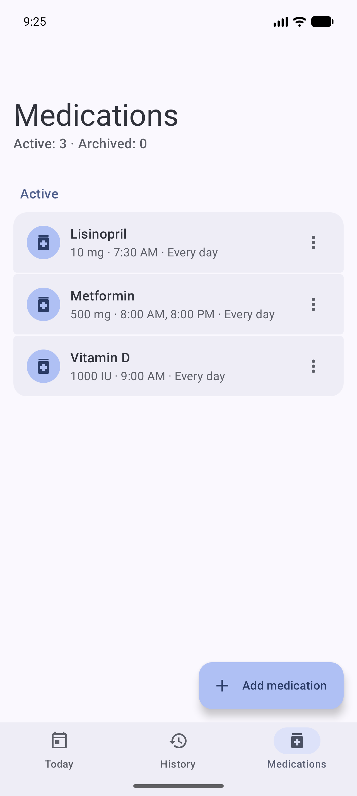
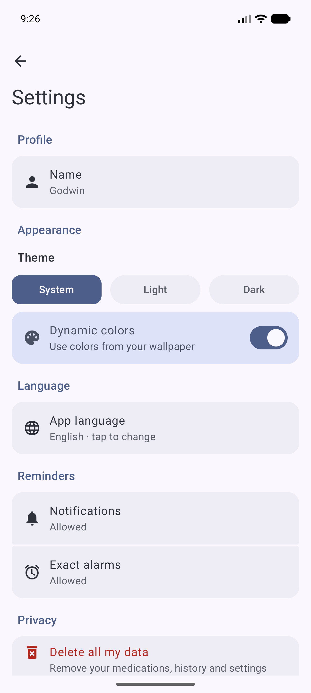
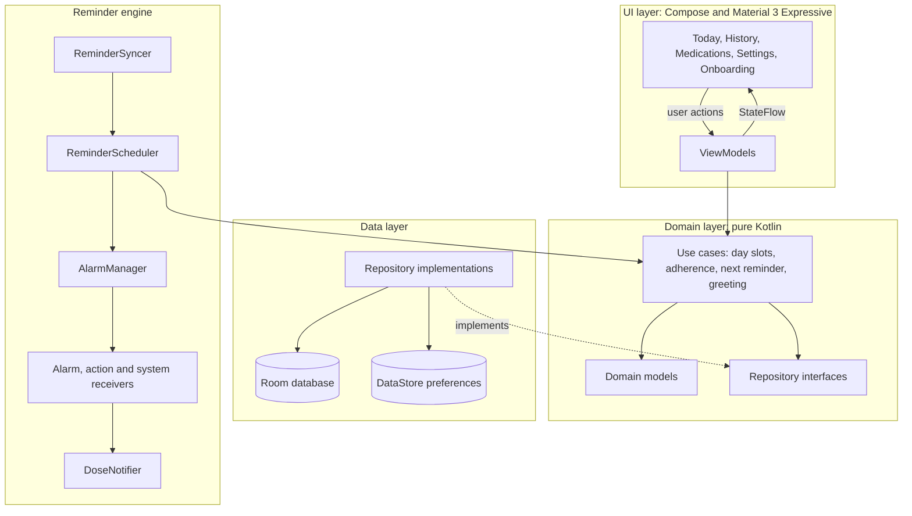

# 💊 MediTrack

A native Android app that helps you **remember and track your medication**, built with **Kotlin**, **Jetpack Compose** and **Material 3 Expressive**.


## Overview

MediTrack is a fully offline health companion: it reminds you when a dose is due, lets you confirm it straight from the notification, and turns your history into an adherence report you can share with your doctor. No account, no cloud, no tracking: everything stays on the phone.

It is a portfolio project focused on **production-grade architecture**, **testable business logic** and a faithful implementation of **Material 3 Expressive**.

## Screenshots

| Today | History | Medications | Settings |
|---|---|---|---|
|  |  |  |  |

## Features

- ⏰ **Reliable reminders**: exact alarms that survive reboots, time changes and permission changes, with **Taken / Skip** actions inside the notification
- 🔒 **Private by design**: the lock screen only shows "Medication reminder", never the medication name
- 👋 **Smart greeting**: time-aware salutation and a contextual message ("Did you take your medication today?", "Next dose at 8:00…")
- 📅 **Adherence history**: 7 and 30-day rates, a color-coded calendar, a streak counter and a per-medication breakdown
- 📄 **PDF report for your doctor**: summary, per-medication table, calendar and the list of missed or skipped doses, generated on-device
- 💊 **Flexible schedules**: several times per day, chosen weekdays, start and optional end date
- 🗄️ **Archive instead of delete**: archived medications keep their history
- 🎨 **Material You**: dynamic color with a curated fallback palette, light, dark or system theme
- 🌍 **Bilingual**: English and French, including per-app language on Android 13+
- 🧹 **Your data, your call**: one tap deletes everything from the device

## Architecture

Clean Architecture with a unidirectional data flow. The domain layer is pure Kotlin, so all the business rules run in plain JVM unit tests.



## Material 3 Expressive

The app uses `MaterialExpressiveTheme` with `MotionScheme.expressive()` and the following components (Material 3 `1.5.0-beta01`):

| Component | Where |
|---|---|
| `LoadingIndicator` | Loading states, PDF export button |
| `LinearWavyProgressIndicator` / `CircularWavyProgressIndicator` | Daily progress, adherence rate, per-medication rate |
| `SegmentedListItem` | Doses, medications, settings, adherence breakdown |
| `ButtonGroup` (clickable and toggleable items) | Taken / Skip, 7 or 30 days, weekdays, theme mode |
| `ToggleButton` | Medication form picker |
| `LargeFlexibleTopAppBar` / `MediumFlexibleTopAppBar` | Collapsing headers with subtitles |
| `ShortNavigationBar` | Bottom navigation |
| `ExtendedFloatingActionButton` | Add medication, export PDF |
| `MaterialShapes` | Onboarding hero shape |

## Technical decisions

- **Statuses are derived, never stored.** A schedule is a rule ("08:00, Mon to Fri"). Whether a dose is *upcoming*, *due*, *missed*, *taken* or *skipped* is computed from the rules, the logged doses and the current time. The database only stores what the user actually did, so there is nothing to keep in sync.
- **One alarm at a time.** A pure use case finds the next unlogged dose within 8 days and arms a single exact alarm for it. When it fires, the app notifies and arms the next one. A `ReminderSyncer` watches the database, so any edit, archive, delete or undo re-arms the alarm automatically.
- **Graceful permissions.** `SCHEDULE_EXACT_ALARM` is requested with an explanation. If it is refused, the app falls back to an inexact alarm and says so. Revoking and granting it again are handled.
- **Health data stays private.** Local-only storage, a generic lock screen notification, PDF reports written to the app's private cache and shared through a `FileProvider`, and a one-tap "delete all my data".
- **Business rules are plain Kotlin.** Day slots, adherence and streaks, next reminder and greeting messages are pure use cases with injected time, covered by more than 55 unit tests.
- **Debug-only sample data.** A broadcast receiver in the `debug` source set seeds 30 days of realistic history for screenshots. It is not part of release builds.

## Tech stack

| Category | Technology |
|---|---|
| Language | Kotlin 2.2.10 |
| UI | Jetpack Compose, Material 3 Expressive |
| Architecture | MVVM, Clean Architecture, unidirectional data flow |
| Dependency injection | Hilt |
| Persistence | Room (schemas exported), DataStore Preferences |
| Async | Coroutines and Flow |
| Scheduling | AlarmManager (exact alarms), broadcast receivers |
| Navigation | Navigation Compose |
| Build | Gradle Kotlin DSL, version catalog, AGP 9 with built-in Kotlin, KSP |

## Project structure

```
com.gcoded.meditrack/
├── data/            # Room database, DataStore preferences, repository implementations
├── domain/          # Pure Kotlin models, repository interfaces and use cases
├── di/              # Hilt modules
├── export/          # PDF report generation and sharing
├── reminder/        # Alarm scheduling, notifications and broadcast receivers
└── ui/
    ├── navigation/  # NavHost and Expressive navigation bar
    ├── screens/     # today, history, medications, medication form, settings, onboarding, splash
    └── theme/       # Material 3 Expressive theme
```

## Getting started

**Prerequisites:** a recent Android Studio, JDK 17 and an emulator or device running Android 8.0 (API 26) or newer.

```bash
git clone https://github.com/Godark14/MediTrack.git
cd MediTrack
./gradlew :app:testDebugUnitTest   # run the unit tests
```

Open the project in Android Studio and run it. To fill a debug build with sample data:

```bash
adb shell am broadcast -n com.gcoded.meditrack/com.gcoded.meditrack.debug.SeedReceiver
```

## Download

A signed APK is available on the [Releases](https://github.com/Godark14/MediTrack/releases) page.

## Roadmap

- Enable R8 shrinking for release builds
- Home screen widget with the next dose
- Configurable "due now" window
- Instrumented UI tests for the main flows

## Disclaimer

MediTrack helps you remember and track your medication. It is not a medical device and does not replace professional medical advice.

## License

Released under the MIT License. See [LICENSE](LICENSE).

---

Built by [Godwin](https://github.com/Godark14) as part of an Android portfolio series.